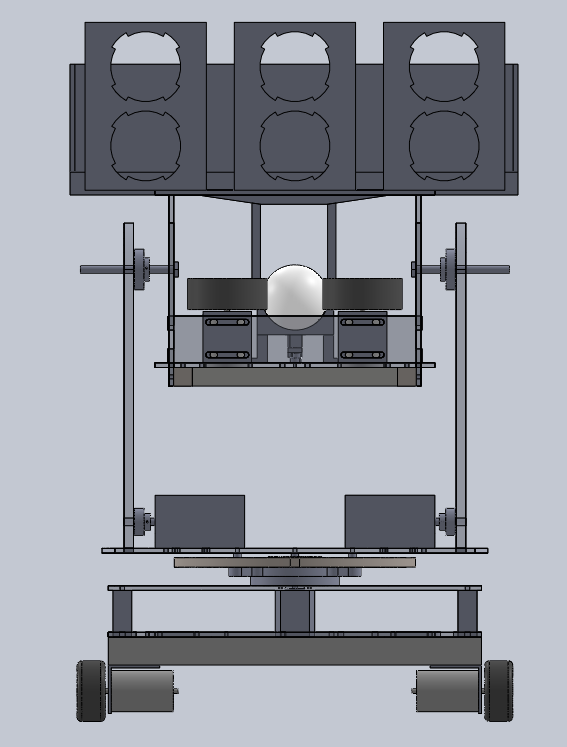
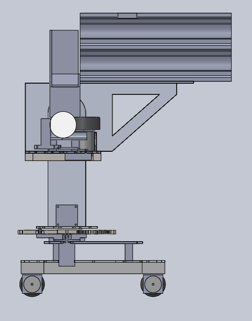
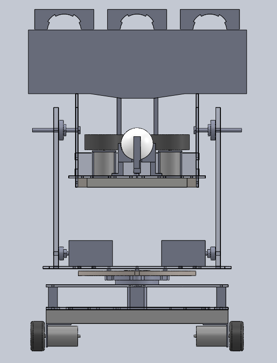
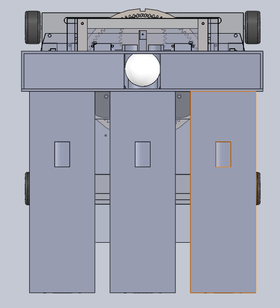

# 2026TEL Robot Combat-嘻諧們

---

**標題：2026 東京威力科創機器人大賽成果報告**  
**撰寫日期：** 2026/11/09  
**隊名：** 嘻諧們  
**指導老師：** 國立成功大學 機械系 張怡玲 教授  
**隊長：** 林敬堯 / 國立成功大學 機械系 115級  
**隊員 1：** 阮紹銘 / 國立成功大學 電機所 116級  
**隊員 2：** 何詺威 / 國立成功大學 機械系 115級  

## 目錄 (Table of Contents)

* **壹、機器人簡介**
  * ➢ 機器人設計及各功能結構介紹
    * 一、車體底盤：結構承重與移動設計
    * 二、車體第二層：砲台承載與水平旋轉機構
    * 三、砲台俯仰機構設計
    * 四、砲台底板：發射裝置與推彈機構
    * 五、砲台上板：彈槽與漏斗供彈系統
  * ➢ 機器人外型
  * ➢ 實際運作與達成度
* **貳、AI 應用項目與成效評估**
  * 一、YOLO 圓孔辨識
    * （一）需求
    * （二）技術原理
    * （三）訓練資料
    * （四）運作流程
    * （五）成效
    * （六）限制與賽前工作
  * 二、Claude 產生比賽操作介面
    * （一）使用方式
    * （二）介面功能
    * （三）成效
  * 三、Claude 協助配線
    * （一）使用方式
    * （二）實例
    * （三）限制
* **參、團隊成員分工說明**
* **肆、預算執行結果**
* **伍、心得與建議**
  * 一、團隊心得
  * 二、後續改善與建議

---

**參賽人員簽名：** \_______________________\_  

**指導教授簽名：** \_______________________\_  

---

# 壹、機器人簡介

## ➢ 機器人設計及各功能結構介紹

### 一、車體底盤：結構承重與移動設計

車體底盤採用 3030 與 3060 鋁擠型材料，配合三角連結塊組裝為矩形主支架，用以承載整體機器人結構，車輪則直接安裝固定於 3060 鋁擠型上。底盤上方鎖固 5mm 厚的壓克力板，作為 MCU、Orin 及馬達驅動器等控制板與電子零件的安裝與固定平台。垂直方向則垂直固定 20 系列、長度 50mm 的鋁擠型，作為支撐車體第二層結構的立柱支架。

### 二、車體第二層：砲台承載與水平旋轉機構

第二層結構採用 5mm 厚的壓克力板鎖固於第一層立柱支架頂端，作為砲台之載台。水平旋轉機構以水平旋轉馬達之輸出軸連結 21 齒太陽齒輪作為驅動源，並搭配由 3 顆 36 齒行星齒輪與 93 齒外環齒輪構成之行星齒輪組，實現約 5.43:1 的減速比，此設計能有效提升輸出扭矩，使馬達承受之負載扭矩降低至原先的 1/5.43。水平旋轉馬達選用 42BYGH60 步進馬達。行星齒輪支架採用 3D 列印製作，並配置止推軸承，能在傳遞旋轉動力的同時，穩定承載上方砲台機構之整體重量。

### 三、砲台俯仰機構設計

俯仰支架由一塊 5mm 厚的底板與兩塊 10mm 厚的側板組裝而成。底板配置兩顆 57 一體式閉環步進馬達，並於兩側連結 20 齒皮帶輪；同時中間進行開孔，透過螺絲與行星齒輪支架穩固連結。側板上方開孔，經打磨處理後的螺絲穿套入側板，用以鎖固 60 齒皮帶輪與砲管側板。皮帶輪提供 3:1 的減速比，能有效將馬達承受的扭矩負載降低至三分之一。

### 四、砲台底板：發射裝置與推彈機構

由 2020 鋁擠型與三角連結塊組裝成矩形支架作為砲台主結構，上方鎖固 5mm 厚壓克力板以放置發射裝置與推彈模組與推彈軌道。發射裝置配備兩顆 775 直流馬達及 85mm 摩擦輪；預計發射初速為 15–18 m/s，馬達轉速需達 5500 rpm 以上。推彈軌道採用 3D 列印製作，底部設計開槽結構以輔助推進。推彈模組同樣以 3D 列印製作並鎖固於滑軌上，連結行程為 20–50mm 的曲柄滑塊機構（移動距離 40mm），驅動源為鎖固於 20mm 連桿上的 TT 馬達。

### 五、砲台上板：彈槽與漏斗供彈系統

砲台上板前端配置三個雙層（上下兩層）彈槽，彈槽側邊設有開孔並安裝六個小型減速馬達連結擋桿，精準控制每次一顆球滾入後方漏斗。漏斗出口對準下方推彈軌道後端，兩側採用對稱開口設計，防止球體落下時偏離軌道，避免發生填彈失敗或卡彈故障。彈槽與漏斗機構皆採用 3D 列印技術製作。

## ➢ 機器人外型

|  |  |
| :---: | :---: |
| 圖一、正視圖 | 圖二、側視圖 |

|  |  |
| :---: | :---: |
| 圖三、背視圖 | 圖四、上視圖 |

## ➢ 實際運作與達成度

在實際運作測試中，車體已實現透過搖桿進行移動操控。此外，水平旋轉馬達、俯仰旋轉馬達、發射摩擦輪馬達、推彈機構馬達及彈槽分流馬達等系統，皆已成功完成電腦控制測試，且影像識別鏡頭亦能精準辨識目標靶。

目前僅剩壓克力板加工完成後的實體組裝，屆時將進行整體功能測試與瞄準精準度調校。目前整體計畫達成度約為 85%。

---

# 貳、AI 應用項目與成效評估

本隊使用三項 AI 技術。機器人上用 YOLO 辨識網框的圓孔；開發階段用 Claude 產生比賽操作介面的程式，並用 Claude 協助配線。

表 2-1　AI 應用項目

| 項目 | 使用的 AI | 使用階段 | 在比賽中的作用 |
| --- | --- | --- | --- |
| 圓孔與亮燈加分孔辨識 | YOLO（yolo11n） | 比賽前 60 秒的自主投球 | 找出 12 個孔的位置，算出瞄準角度 |
| 比賽操作介面 | Claude（Anthropic 的大型語言模型） | 開發階段 | 第 61 秒起的手動操控 |
| 配線 | Claude | 開發階段 | 分配腳位、寫接線步驟、判讀量測結果 |

本節的數字分成兩類：「模擬」和「合成評估」來自電腦上的物理模擬與程式產生的影像；「實機」來自硬體實際量測。

## 一、YOLO 圓孔辨識

### （一）需求

規則規定比賽前 60 秒不得遙控。加分孔在哨響時從 3 格中隨機亮起 1 格，60 秒後熄滅（官方 Q34）。因此加分孔的得分全部發生在自主階段，機器人要自己在 6 m 外找出 9 個一般孔（Ø40 cm）和 3 個加分孔（Ø20 cm），並分辨哪一個加分孔亮著紅燈。

### （二）技術原理

- YOLO（You Only Look Once）是單階段的物件偵測模型。影像經過一次 forward pass，模型同時輸出每個物件的 bounding box 和類別。
- 本隊選用 yolo11n，是 YOLO11 系列中最小的版本，因為機器人上的運算平台是 NVIDIA Jetson Orin Nano Super，算力比桌上型 GPU 低。
- 模型分三個類別：一般孔（main）、加分孔（bonus）、亮燈的加分孔（bonus_lit）。
- 後續計算只需要每個孔的中心與直徑，bounding box 就能提供，所以用一般的偵測模型，不用 pose 或 segmentation 模型。

### （三）訓練資料

訓練時沒有實際網框的照片，所以訓練資料由程式產生：

1. 依官方尺寸標示圖建立網框模型：一般孔 Ø40 cm、加分孔 Ø20 cm、欄距 0.90 m、列距 0.60 m。
2. 在距離 2.5 到 7.5 m 之間隨機放置相機，把每個圓孔投影成影像中的橢圓。程式知道每個孔的真實位置，所以標註由程式產生，不需要人工標註。
3. 加入 domain randomization：隨機改變背景、眩光、模糊和色偏，讓模型不依賴特定的光線與顏色。
4. 亮燈加分孔依官方 Q33 的說明，畫成孔緣的紅色 LED 燈環。

訓練設定：2000 張影像、80 epochs、輸入解析度 960×960，在筆電的 RTX 4050 Laptop GPU 上訓練約 3.5 小時。

### （四）運作流程

自主階段每投一球的步驟如下：

1. 轉塔轉到掃視姿態，讓 IMX296 相機（6 mm 鏡頭，去畸變後 1456×1088）拍到整面網框。
2. YOLO 偵測影像中的孔，輸出每個孔的中心、直徑和類別。
3. 程式依網框的已知尺寸做整板 PnP（Perspective-n-Point），求出網框相對於相機的位置與角度。接著把 12 個孔投影回影像，把每個偵測框配給距離最近的孔編號，再解一次 PnP。這一步處理多偵測或漏偵測的框。
4. 程式算出每個孔相對於砲管的距離、水平角和俯仰角。
5. 策略模組在 60 秒內優先選亮燈的加分孔，60 秒後只選一般孔。
6. 彈道模型包含空氣阻力，用 RK4 數值積分預先建表，反解出轉塔的俯仰角和水平角。
7. Jetson 經 USB 把角度送給微控制器（NUCLEO-G474RE），由微控制器驅動轉塔與發射機構。
8. 賽前練習投 9 球，程式依落點誤差算出角度修正量；比賽中套用這組修正量。

### （五）成效

表 2-2　YOLO 與定位流程的評估結果

| 項目 | 條件 | 結果 | 類型 |
| --- | --- | --- | --- |
| 偵測準確度 | 驗證集 | 三個類別的 mAP50 都是 0.995 | 合成評估 |
| 6 m 定位 | 60 張影像 | 整板 PnP 成功 60/60；亮燈孔辨識 50/50；距離誤差中位數 0.2 cm；水平角與俯仰角誤差 0.01°；孔編號配錯 0 次 | 合成評估 |
| 實機相機的視野 | IMX296 + 6 mm 的實測內參，掃視姿態 | 12 個孔全部入鏡，距離畫面邊緣至少 218 px | 模擬 |
| 整場投球 | 渲染影像 + YOLO，使用實機相機內參，6 場 | 平均 51.0 分，命中率 90%，加分孔命中率 44% | 模擬 |
| 每球用時 | 實際韌體 + 合成相機 + 彈道模擬，使用 YOLO | 整場 50 分，平均每球 1.40 s | 模擬 |
| Orin 推論速度 | TensorRT FP16、960×960、連續 300 s | 平均 8.95 ms，每秒 122 張 | 實機（只含模型） |
| 相機取像 | IMX296，含 ISP | 59.2 fps（每張 16.9 ms） | 實機 |

mAP50：預測框與標註框的交集除以聯集（IoU）≥ 0.5 時算偵測正確，以此計算各類別的 average precision 後取平均。

- YOLO 在 Orin 上推論一張需要 8.95 ms，相機取一張需要 16.9 ms，所以 YOLO 不會降低取像速度。
- 用 4S 電池供電時，推論速度和用變壓器供電相差 0.2% 以內，連續 300 s 沒有降頻（實機）。

### （六）限制與賽前工作

- 訓練資料全部是合成影像，實際網框的辨識率還沒有量測。現場的光線或背景和合成資料差異線線大時，辨識率可能下降。
- 賽前計畫：用等比例孔板加紅色 LED 實拍，先用目前的模型預先標註，人工修正後再微調模型。

## 二、Claude 產生比賽操作介面

### （一）使用方式

開發時使用 Claude Code，這是 Anthropic 的大型語言模型 Claude 在 VS Code 中的程式開發工具。流程如下：

1. 隊員用文字說明需求，並提供規則條文與硬體規格。
2. Claude 撰寫程式與自動化測試，並在電腦上執行測試。
3. 隊員在實機上操作，把結果與問題回報給 Claude，Claude 再修改。

專案規定 Claude 每次修改後，要在變更紀錄寫下原因與測試結果。

### （二）介面功能

操作介面是網頁。伺服器在機器人上的 Jetson 執行，操作手的筆電用瀏覽器經自備的路由器連線，不經過網際網絡。

表 2-3　操作介面的功能

| 功能 | 說明 |
| --- | --- |
| 相機畫面 | 機器人相機的影像以 MJPEG（Motion JPEG）串流到瀏覽器 |
| 預估落點 | 使用自主階段的彈道模型，依轉塔目前的角度和飛輪轉速算出球的落點，畫在相機畫面上：會進的顯示綠色，不會進的顯示橘色；右下角另有網框的小地圖 |
| 輸入裝置 | 鍵盤或搖桿。搖桿的左搖桿控制前後與平移，右搖桿瞄準，右扳機（RT）開飛輪，A 鍵發射，B 鍵停止 |
| 底盤控制 | 底盤是麥克納姆輪，介面把前後、平移、旋轉三個輸入換算成四個輪子的輸出 |
| 前 60 秒鎖定 | 比賽開始後 60 秒內由 AI 控制，伺服器拒絕所有手動指令，不依賴網頁端的限制 |
| 單一駕駛 | 伺服器同一時間只接受一個連線的操控指令，其他連線只能觀看，對應「一個遙控器、一人操作」的規則 |
| 停止保護 | 超過 300 ms 沒有收到輸入時，伺服器把移動指令歸零；連線中斷時停止 |
| 微控制器重新開機 | 偵測到微控制器重新開機時，自動恢復轉塔原點、目標角度和飛輪轉速，並在頁面上方顯示紅色警告 |
| 不能發射的原因 | 發射被拒絕時，頁面列出缺少的條件，例如「還沒歸零」或「飛輪還沒到速」 |

### （三）成效

- 2026-11-04 在學校實測，Jetson 只用無線網路（2.4 GHz 頻道 8）：瀏覽器和 Jetson 之間的往返時間一般約 2 ms，最高 9.0 ms；在 6 m、10 m 和隔一面牆的位置都沒有斷線；自主階段鎖定、切換手動、按鍵輸入、放開按鍵後歸零都正常（實機）。
- 同一天用實體搖桿經 Wi-Fi 操作轉塔，搖桿輸入可以控制俯仰角和水平角（實機）。
- 在電腦上的區網測試中，瀏覽器送出指令到收到微控制器回覆需要 0.61 ms（微控制器以韌體模擬器代替，模擬）。
- 混控、停止保護、前 60 秒鎖定等功能都有自動化測試，每次修改後執行。目前全專案 97 個測試通過。
- 場館的攝影機使用 5.1 到 5.9 GHz，無線干擾要在練習日到場館再測。

## 三、Claude 協助配線

### （一）使用方式

隊員提供元件型號、接線照片和三用電表的量測值。Claude 查元件的 datasheet、分配微控制器的腳位、把接線步驟寫成文件，並判讀量測結果。每一步接完後，隊員量測並回報，再進行下一步。

腳位分配的例子：4 個車輪編碼器分別使用 TIM4、TIM20、TIM1、TIM5 的 encoder mode；TIM2 和 TIM3 要輸出摩擦輪與推彈的 PWM，所以編碼器不使用這兩個計時器。

### （二）實例

表 2-4　配線問題與處理

| 問題 | 量測或觀察 | 判斷與處理 | 結果 |
| --- | --- | --- | --- |
| 車輪編碼器讀不到訊號 | 編碼器接 3.3 V 時，A、B 訊號只在 2.4 到 2.7 V 之間變化 | STM32 的輸入要低於約 0.99 V 才判為 LOW，所以讀值一直是 1。查 STM32G474 的 datasheet（DS12288）後，發現 PC1、PA0、PB2 只能承受 4 V，不能直接接 5 V 訊號 | 編碼器改接 5 V，每條訊號線加 20 kΩ 電阻到 GND 分壓。用手轉輪子時，四顆編碼器的計數都會變化（實機） |
| 四輪轉向和編碼器正負不一致 | 輸出 40% 時，有的輪子往後轉，有的輪子往前轉但 rpm 為負 | 依每一輪的實際轉向和 rpm 正負，判斷是馬達線接反還是編碼器計數反向。修改韌體的反向設定，並請隊員對調兩片驅動板的 M+、M− | 四輪都往車頭方向轉，rpm 為 +62.1 到 +68.9（實機） |
| 步進馬達驅動板 DRV8825 的電流設定 | 出廠的 Vref 量到 1.6 V | 依 DRV8825 的公式，電流上限是 Vref × 2 = 3.2 A，超過馬達額定的 1.5 A，所以建議調到 0.75 V 以下 | 調到 0.66 V（電流上限 1.32 A）後，水平步進馬達以 3200 個脈衝正轉 1 圈、反轉 1 圈後回到原位，確認 16 微步的設定正確（實機） |
| 車輪馬達電壓 | 車輪是 12 V 馬達，電池是 4S LiPo（充飽 16.8 V） | 韌體把輸出上限設為 71.4%（12 ÷ 16.8） | 搖桿推到底時輸出 71.4%，以 16.8 V 計算，馬達的平均電壓約 12 V |

### （三）限制

- Claude 只能依文字和照片判斷。照片看不清楚的接腳，由隊員對照板上的印字確認。
- Claude 曾在回覆中寫錯一支腳的位置（把 A3 說成在 D7 旁邊），但文件中的腳位表是正確的。因此每次通電前，隊員依文件和板上印字逐條確認接線，並用三用電表的蜂鳴檔檢查有沒有短路。

---

# 參、團隊成員分工說明

本專案由團隊成員共同協作完成，各成員具體分工如下表所示：

表 3-1 團隊成員分工表

| 姓名 | 主要分工與職責範疇 | 
| :---: | :---: | 
| **何詺威** | 砲台與旋轉機構設計、採買、硬體加工、攝影 | 
| **林敬堯** | 比賽策略制定、控制系統架構設計、車輪底盤和彈倉設計採買、硬體加工、影片剪輯 | 
| **阮紹銘** | YOLO 選型訓練、鏡頭校正與介面編寫、操作與瞄準系統設計與編寫、電路協助 | 

---

# 肆、預算執行結果

本計畫實際採購之零組件、材料與設備開銷如下表所示：

表 4-1 實際開銷明細表

| 品項 | 用途 | 金額 | 
| ----- | ----- | ----- | 
| M3螺絲、保險絲、開關 |  | 118 | 
| M2、M2.5、M3、M4、M8螺絲、M8華司、M8螺帽 |  | 234 | 
| 30系列 M3嵌入式螺帽、螺絲、華司 |  | 136 | 
| 鋁擠型3060 400L\*2、3030 280L\*2、2020 200L\*2、2020 220L\*2、2020 5L\*4 | 車體、砲管支撐框架 | 910 | 
| 三角連結塊-30系列\*12、20系列\*12 與配件螺絲組 | 連結鋁擠型 | 1136 | 
| 壓克力500\*800\*5-4、50\*50\*10-2、30\*30\*10-1 |  | 4360 | 
| 止推軸承\*1、一般軸承\*4 | 行星齒輪組 | 637 | 
| 法蘭聯軸器 | 連接水平馬達與太陽齒輪 | 50 | 
| 70mm短滑軌 | 推球裝置滑軌 | 96 | 
| 775直流馬達\*2 | 發射摩擦輪馬達 | 720 | 
| 直流馬達調速器\*2 | 摩擦輪馬達調速 | 360 | 
| 775馬達支架\*2 | 摩擦輪馬達固定 | 138 | 
| 65mm摩擦輪\*2、聯軸器\*2 | 摩擦輪 | 200 | 
| 90度托架\*3 |  | 223 | 
| 85mm摩擦輪\*2 | 摩擦輪 | 552 | 
| 電機驅動模組BTS7960\*2 | 摩擦輪馬達驅動 | 300 | 
| 57-76一體式閉環步進馬達\*2 | 俯仰旋轉馬達 | 2724 | 
| 57馬達支架\*2 | 固定俯仰馬達 | 300 | 
| T20-T60 1:3傳動皮帶輪 | 俯仰動力傳遞 | 960 | 
| 樹莓派gs相機 | 單價2850，Ben個人有買一個（共5985） | 3135 | 
| 256 GB MicroSd卡 | orin開機韌體和模型儲存 | 2085 | 
| NUCLEO-G474RE4RE | orin下級微控制器 | 1349 | 
| 麥克納姆輪和聯軸器 | 機器人移動 | 696 | 
| 16awg電線(紅黑共8尺)、降壓模組、xt60、DC圓形插頭、插版電池盒、杜邦線、N20馬達驅動器\*6、風扇、wago端子 | 電子材料 | 1353 | 
| 車輪編碼馬達\*4 | 車輪驅動 | 1836 | 
| orin壓克力盒 | orin安裝用支架 | 450 | 
| BTS7960 | 車輪馬達驅動器 | 608 | 
| 遙控手柄、路由器、網路線 | 機器人手動遙控器材 | 3278 | 
| 電池盒、18650電池\*4、三用電表、降壓模組(已遺失)、塑膠隔離柱、六角板手、18650充電器、塑膠墊片 | 電子零件 | 2540 | 
| DRV8825\*2 | 水平旋轉馬達驅動器 | 276 | 
| 水平旋轉步進馬達 | 讓砲台水平旋轉 | 540 | 
| 定位銷80mm、30mmm、聯軸器 | 彈倉零件 | 576 | 
| 同步皮帶 | 彈倉零件 | 312 | 
| N20馬達 | 彈倉零件 | 1470 | 
| 光軸固定座 | 彈倉零件 | 300 | 
| 定位皮帶輪、惰輪 | 彈倉零件 | 372 | 
| drv8825固定座 | 方便drv8825接線、安裝 | 105 | 
| 麵包板\*4、保險絲座\*8、wago端子、熱縮套、14&18awg多芯線各三尺 | 電子零件 | 1015 | 
| 4S 5.2ah xt60接頭Lipo電池\*2 | 機器人電源 | 2780 | 
| wago端子(一進七出、一進四出)、小塊麵包板、40cm杜邦線(公公、公母各2) | 電子材料 | 299 | 

主辦方提供的經費皆有得到有效的使用於各機器人的重要材料。與當初計畫不同的是 Orin 因為近期漲價的緣故，超出我們可以接受的預算，因此改為使用隊員個人的 Orin Nano，僅採買新的 Micro SD 卡用於作業系統和模型儲存。

---

# 伍、心得與建議

## 一、團隊心得

1. **機構設計與製造決策之經驗**：
   在設計時應以過往熟悉的機構和加工方式出發。初始設計時因為對後續的加工和對特殊機構的不熟悉，因此導致大量時間資源上的浪費，此後面對這種情況，應該先參考能夠確保快速設計和製造的選項，而非在挑戰設計上花費過多時間。

2. **跨領域技術整合驗證**：
   本專案成功結合了機械機構設計（齒輪減速比、曲柄滑塊與 3D 列印供彈）、電路配線（STM32 腳位與訊號分壓）以及前沿 AI 算法（YOLO11n 視覺辨識、PnP 姿態估算與 RK4 彈道模型）。透過實作，團隊深入理解了軟硬體整合時可能遇到的訊號干擾與電壓匹配問題。

3. **AI 工具輔助開發與 CAD 驗證效益**：
   在開發過程中導入 LLM (Claude) 協助編寫 Web 操作介面、自動化測試範例以及配線腳位對照，極大地縮短了控制系統與韌體對接的除錯時間。此外，Claude 能直接讀取 SolidWorks 匯出的 STL 檔案進行分析，使團隊能夠更快速地完成幾何驗證，進而加速機電整合進度、即時對機構設計進行修改，甚至針對所需的零組件提出精準的採買建議。

## 二、後續改善與建議

1. **實體模型微調與照明適應性**：
   由於目前 YOLO 訓練集完全基於合成影像生成，建議在賽前練習階段使用現場或等比例實體網框進行照片採集，透過人工標註修正後微調模型，以提升實體場景下對複雜光線與眩光的抗干擾能力。

2. **場域無線電干擾預備方案**：
   競賽場館內常有多組無線攝影與通訊設備（可能佔用 $5.1 \sim 5.9\,\text{GHz}$ 頻段）。建議練習日進行現場頻譜量測，並備妥可切換 2.4GHz 與 5GHz 頻道之路由器，或隨時調整 MJPEG 串流畫質以降低傳輸頻寬需求。

3. **實機整體調校**：
   待壓克力與機構零組件全數加工完成後，應儘速完成實體總裝，並進行真實彈道連發測試，校正落點誤差修正量以達到最高命中率。