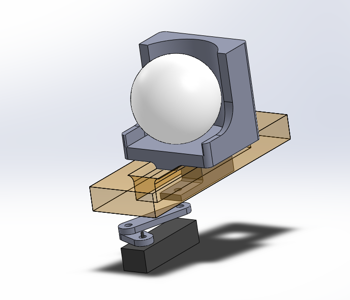
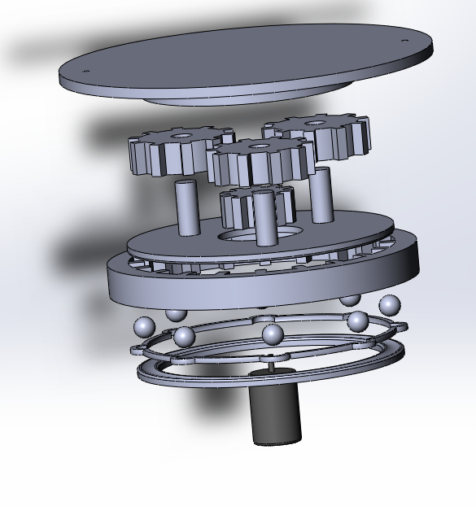
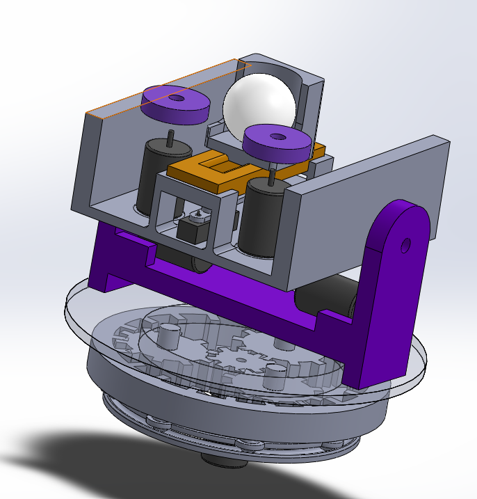
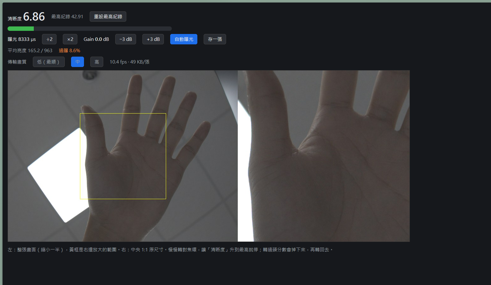

# 工程專題進度報告

## 一、 專題團隊資訊
* **指導教授**：張怡玲 教授
* **專題隊長**：林敬堯
* **團隊成員**：何詺威、阮紹銘

---

## 二、 目前系統設計與進度報告

### (一) 機構設計 (Mechanical Design)
1. **發射裝置**
   * **連桿幾何與行程設定**：將滑塊設定為從動件，短曲柄長度為 $2\text{ cm}$，長曲柄長度為 $5\text{ cm}$。依據幾何公式計算，極點位置分別距離馬達 $7\text{ cm}$ 與 $3\text{ cm}$，滑塊移動總行程為 $4\text{ cm}$。
   * **滑塊防摔與減震機制**：滑塊後方設計略大於球體半徑的弧形牆壁提供支撐，兩側配置 L 型支架防止推進過程中球體脫落。滑塊中央鋪設海綿，用於吸收球體落下的衝擊力並提升摩擦力。
   * **發射流道優化**：改為開放式空間發射，避免球體發射時碰撞舊版砲管壁而降低精準度。理想狀態下使球體於正中心接觸摩擦輪後發射，確保發射路徑具備良好同軸度。
   * 

2. **旋轉機制**
   * **鉛垂方向**：採用市售鏈條與齒輪組合進行旋轉驅動。上方大齒輪與發射裝置旋轉軸結合，下方透過鏈條連接固定於 Y 型垂直支架上的小齒輪，兩側各配置一組馬達固定結構。整體結構尺寸約為寬 $32\text{ cm}$、高 $30\text{ cm}$。
   * **水平方向**：採用承重軸承承載發射裝置與彈槽的重量，並搭配行星齒輪組降低馬達負載扭矩。整體結構尺寸約為寬 $25\text{ cm}$、高 $8\text{ cm}$。
   * 

3. **供彈裝置**
   * **防卡彈機制**：採用日內瓦機構（Geneva Mechanism）結合 C 型閥門，實現單次精準供給一顆球，防止連續進彈造成卡彈或堵塞。
   * 

4. **車體空間配置**
   * **車體上板**：整合旋轉機構、發射裝置及供彈裝置，整體占用空間約 $L \times W \times H = 30 \times 30 \times 40\text{ cm}$。
   * **車體底板**：配置車輪、驅動馬達、各主控板與配線空間，整體占用空間約 $L \times W \times H = 45 \times 45 \times 12\text{ cm}$。

---

### (二) 視覺辨識系統 (Visual Recognition System)
1. **核心驅動與韌體整合**
   * 由於 NVIDIA Jetson Orin 與樹莓派鏡頭（Raspberry Pi Camera）之間缺乏原廠一對一搭配的韌體，目前採用網路開源 Kernel 驅動，並搭配指定的 JetPack 環境完成安裝與系統建構。
2. **系統連結與鏡頭校正**
   * 目前已完成從鏡頭到 Jetson Orin 整個影像系統的物理連結與色差調整。
   * 已完成 Camera 本身的內部參數（Intrinsic Parameters）校正並記錄相關數據。
   * 
1. **現階段技術挑戰與潛在問題**
   * **遠距離投球與座標轉換**：配合鏡頭視角與空間座標轉換，機器人預計需要在 $2.5\text{ m}$ 以外進行投球（目前規劃參數設為 7）。
   * **解析度對精度的影響**：在較遠距離下若解析度變小，將導致座標轉換誤差增大，後續需針對不同解析度重新進行投球誤差測試與修正。

---

## 三、 預期進度與加工採購規劃

### (一) 元件加工製作
1. **雷射切割**：車體底板、車體上板、曲柄滑塊連桿。
2. **3D 列印**：推球裝置滑塊、旋轉平台、Y 型支架。

### (二) 零件採購清單
* 軸承、齒輪組、鏈條、馬達、車輪、摩擦輪、鋁擠型固定部件及螺絲等固定零件。

---

## 四、 待辦事項與驗證計劃 (To-Do List)

1. **通訊與 Ready 訊號整合**
   * 確認 Jetson Orin 與 Arduino 之間的通訊協定，以及 Ready 狀態訊號的傳遞機制。
2. **場地建造與模擬訓練**
   * 搭建實際的投球測試場地，進行實境模擬訓練與雜訊參數修正記錄。
   * 測試將分為**室內**與**室外**兩種環境分別進行，以評估環境光線與干擾雜訊對視覺辨識及投球精準度的影響。
3. **機器人 Configure 參數定案**
   * 量測並確認實際機器人的各項物理與控制參數，作為系統配置檔（Configure）的最終定案數值。
4. **雙向通訊協定驗證**
   * 測試並確認主控端與微控制器之間的通訊協定是否能穩定進行雙向資料傳輸。